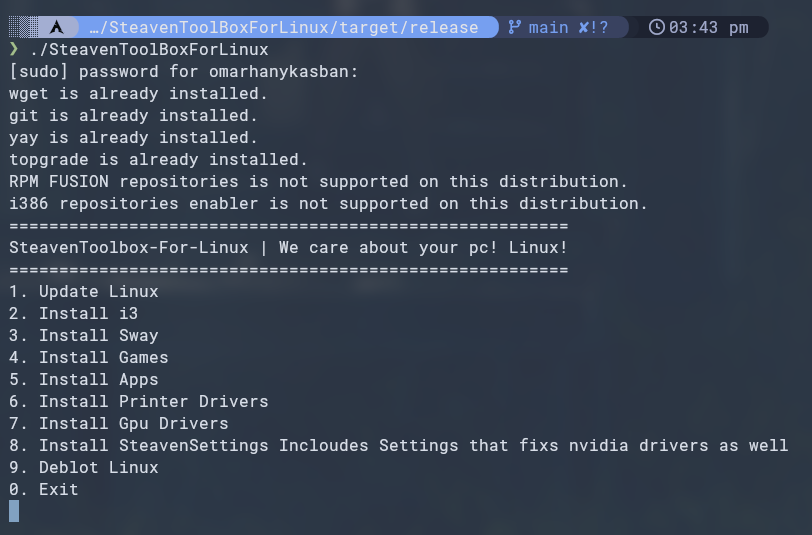

# SteavenToolBoxForLinux

A Free Open Source Modular Toolbox for Arch Linux, Fedora, Ubuntu, and Debian — rewritten 100% in Python!

> **Readme**



## Launching the Toolbox

### Interactive Menu
Run directly with Python 3:

```bash
python3 main.py
```

### Direct Remote Launch
```bash
curl -sSL https://raw.githubusercontent.com/SteavenToolBox/Linux/main/main.py | python3
```

---

## Command-Line Automation

You can also run specific setup routines directly via CLI flags:

```bash
# Update system packages (installs and runs Topgrade)
python3 main.py --update

# Install Topgrade only
python3 main.py --topgrade

# Install software suites
python3 main.py --games
python3 main.py --apps
python3 main.py --printer

# Install window managers & desktops
python3 main.py --i3
python3 main.py --sway
python3 main.py --hyprland
python3 main.py --gnome
python3 main.py --kde

# Auto-detect hardware & install GPU drivers (Nvidia, Intel, AMD)
python3 main.py --drivers

# Debloat system
python3 main.py --debloat

# Force target distribution (arch, fedora, ubuntu, debian)
python3 main.py --distro fedora --apps
```

### Standalone App Execution
Because every app has its own dedicated file, you can also execute each module directly:

```bash
python3 -m steaventoolbox.games
python3 -m steaventoolbox.apps
python3 -m steaventoolbox.i3
python3 -m steaventoolbox.sway
python3 -m steaventoolbox.printer
python3 -m steaventoolbox.drivers
python3 -m steaventoolbox.debloat
python3 -m steaventoolbox.pacman
```

---

## Project Architecture (Python Student Guide)

Every tool, suite, and post-installation task is modularized in its own independent Python file:

```
SteavenToolBox/
├── main.py                     # Primary executable entrypoint & CLI argument parser
└── steaventoolbox/             # Core Python package
    ├── __init__.py             # Package exports and version metadata
    ├── core.py                 # Distro detection, subcommands, colors, and group utilities
    ├── prerequisites.py        # Distro dependency checks (wget, git, yay, RPM Fusion, i386)
    ├── update.py               # System upgrade routines (topgrade, dnf, apt)
    ├── games.py                # Gaming suite, Proton, Wine, launchers, emulators, Minecraft
    ├── apps.py                 # Desktop apps, CLI utilities, disks managers, SSH/Syncthing
    ├── i3.py                   # i3 Window Manager, Xorg, polybar, rofi, picom, themes
    ├── sway.py                 # Sway Wayland compositor, Waybar, Grim, Rofi-wayland
    ├── hyprland.py             # Hyprland Wayland compositor setup
    ├── gnome.py                # GNOME desktop environment setup
    ├── kde.py                  # KDE Plasma desktop environment setup
    ├── printer.py              # CUPS printing subsystem and driver manifests
    ├── drivers.py              # Hardware auto-detection & GPU driver installation
    ├── debloat.py              # System debloating (manifests embedded in Python)
    ├── steavensettings.py      # SteavenSettings repository installer
    ├── pacman.py               # Pacman optimizations and CachyOS/Chaotic-AUR mirrors
    └── menu.py                 # Interactive terminal user interface loop
```

### Key Python Concepts Implemented
- **Standard Library Only**: Built using Python's built-in libraries (`subprocess`, `pathlib`, `argparse`, `sys`, `os`, `shutil`, `re`, `enum`, `typing`). No external pip dependencies required to get started.
- **Type Annotations**: Clear type hinting for functions and arguments (`DistroType`, `List[str]`, `Optional[Path]`).
- **Clean Subprocess Handling**: Safe, logged command execution wrapping `subprocess.run` with both streaming and capturing modes.
- **Cross-Platform Linux Detection**: Dynamic discovery via `/etc/os-release` parsing.
- **Modular OOP & Functional Design**: Easy to extend with new distributions or software packages.
